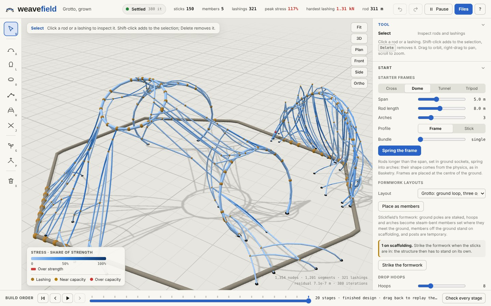

# Weavefield

Grow woven stick structures on a live physical model.

*This repository is named after Stickfield, the structure generator Weavefield grew out of.*

Every rod in Weavefield is a chain of springs that bends and settles under its own weight. Every lashing is a spring
that can slip. What you see is always the relaxed shape, and the stresses, lashing forces and ground reactions come
from it. When the design works, export the cut list and lashing schedule and build it.



## Try it

**Download [Weavefield.html](../../releases/latest/download/Weavefield.html)** from the latest release and double-click
it. It runs in your browser, entirely on your computer: no install, no account, no internet. It works in a recent
Chrome, Edge, Firefox or Safari on Windows, macOS, Linux or ChromeOS. Phones and tablets can't run an HTML file saved on
them.

Everything is in that one file, so you can share it by email, a shared drive or a USB stick.

## What you can do

- **Start from a frame.** Spring a cross, dome, tunnel or tripod: rods longer than the span bow into arches in their
  ground sockets. Or place a formwork layout (grotto, nest, tunnel, twin hoops, a spiral of posts, a pole triangle) as
  real members, with scaffolding you strike later.
- **Build by hand.** Spring arches between two points, stand loops, ring the structure with hoops, lay rods along a
  path, weave between two rods, and lash rods together.
- **Grow sticks.** Families of sticks follow flow fields around the members. Each one is held in two places, lashed
  where it crosses others, kept out of openings, and meets the ground steeply. Each batch settles under its weight
  before the next one grows on it.
- **Feel it.** Push and pull any point and read the force your hand needs. Raise the weight to see the margin.
  Lashings past their slip load come undone.
- **Check it.** See peak stress, the hardest-working lashings, ground sockets against the soil, sticks lying uselessly
  on the ground, and rods longer than stock. One click removes overstressed or lying sticks, or binds overloaded
  lashings twice.
- **Replay the build.** Scrub back through the build order to see the half-built structure under its own weight, with
  the scaffolding still in. *Check every stage* charts which stages sink, slip, or overstress a rod before later work
  holds it.
- **Take it to the workshop.** Export a cut list, a lashing schedule with marks on each rod, a Rhino/Fologram model
  with its importer, and an OBJ. Designs save as files and open in any copy of Weavefield.

## How it works

- **Rods** are chains of nodes about 30 cm apart, with stretch and bending springs. Sticks bent cold spring back;
  steam-bent members and soaked sticks keep the shape they were bent to; bundles act partly as one.
- **Lashings** are springs between a point on each of two rods, with a working capacity and a slip load.
- **The solver** relaxes the whole structure continuously (dynamic relaxation with kinetic damping), so every edit
  settles in front of you.
- **Stresses** come from the timber species' stiffness and strength, and **ground sockets** are checked against the
  soil.

Rods pass through each other (only lashings and the ground connect them), stresses are indicative, and the soil model
is simple. Test critical joints and sockets before you build.

## Building from source

You need Node 18 or later and nothing else:

```bash
npm run build    # writes dist/Weavefield.html (the offline copy) and dist/weavefield.html (the published page)
npm test         # physics against beam theory, model operations, growth on every layout
```

The browser tests use Playwright with Chromium:

```bash
npm ci && npx playwright install chromium
npm run test:smoke
npm run test:browser
```

Every push builds the tool and runs the tests on GitHub Actions; the built `Weavefield.html` is attached to each run.
Publishing a release on GitHub (for example `v1.1.0`) builds the tool and attaches `Weavefield.html` and
`Weavefield.zip` to it.

## Contributing

Contributions are welcome, from people and from their coding agents. Start with [CONTRIBUTING.md](CONTRIBUTING.md).
[CLAUDE.md](CLAUDE.md) explains how the code is put together, the physics, the conventions and how to check a change.

## Credits

The rod and lashing physics follow [Basketry by Grunch](https://runchat.com/p/grunch/basketry-684). The stick families,
flow fields, formwork layouts, ground rules and fabrication exports come from Stickfield, the tool Weavefield grew out
of. The offline copy includes [three.js](https://threejs.org) (MIT) and the fonts Bricolage Grotesque, Instrument Sans
and JetBrains Mono (SIL Open Font License 1.1). Timber properties come from PROTA and the Wood Database (sources are
linked in the app).

Weavefield is released under the [MIT licence](LICENSE).
